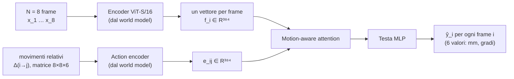

# Guida della sonda ecografica con un world model pre-addestrato: fine-tuning di EchoWorld sul dataset IFL

*Report tecnico, 11 novembre 2026. Codice: [mocap/finetuning/guidance.py](mocap/finetuning/guidance.py).
Configurazione: [configs/guidance.json](configs/guidance.json). Run di riferimento: `runs/guidance_trimmed_v1`.*

---

## Abstract

Durante un esame ecografico l'operatore sposta la sonda finché non trova una *vista standard*, cioè un
piano anatomico predefinito. In questo lavoro la vista standard è quella in cui rene e fegato sono
visibili insieme. Vogliamo un modello che, guardando l'immagine corrente e le ultime immagini acquisite,
dica di quanto traslare e ruotare la sonda per raggiungere quella vista. Seguiamo il secondo stadio di
EchoWorld (CVPR 2025, Sez. 3.3). Un encoder visivo pre-addestrato come *world model* (cioè addestrato a
prevedere come cambia l'immagine quando la sonda si muove) viene affinato insieme a un modulo di
attenzione. Questo modulo combina i frame recenti in base ai movimenti della sonda, misurati dal tracker
tra un frame e l'altro. Rispetto a EchoWorld, che lavora con 10 piani cardiaci annotati, nel nostro
dataset ogni episodio termina sulla stessa vista. L'ultimo frame dell'episodio fa quindi da obiettivo e
basta per costruire le label senza annotazioni aggiuntive. Sul test set (23 episodi) il modello predice
la posizione dell'obiettivo con un errore medio di 15,6 mm in traslazione e 7,4° in rotazione. Le baseline
banali sbagliano di 49–56 mm e di 12–14°. Il vantaggio cresce con la distanza dall'obiettivo. Molto vicino
all'obiettivo, invece, il modello è peggiore della baseline "stai fermo".

---

## 1. Introduzione

Trovare una vista standard richiede esperienza. Il sonografo guarda l'immagine e ne riconosce l'anatomia.
Ricorda anche cosa ha visto poco prima e dove ("qualche centimetro fa si vedeva il fegato"). Mette
insieme le due cose per decidere la prossima mossa. EchoWorld formalizza questo processo in due stadi.

1. **Pre-training del world model** (già fatto, vedi `MOCAP_REPORT_IT.md`). Un encoder ViT impara a
   rappresentare le immagini ecografiche. Lo fa con due obiettivi. Il primo è ricostruire nello spazio
   latente le parti mascherate di un'immagine (I-JEPA). Il secondo è prevedere la rappresentazione
   dell'immagine che si vedrebbe dopo un dato movimento della sonda. Alla fine l'encoder "sa" come
   cambia l'anatomia quando la sonda si muove.
2. **Fine-tuning per la guida** (questo report). L'encoder viene riutilizzato in un modello che riceve
   pochi frame recenti e i movimenti relativi fra di essi, e predice il movimento verso la vista
   standard.

L'idea centrale del secondo stadio è la *motion-aware attention*. Un'immagine vista in passato è utile
solo se si sa dove si trovava la sonda in quel momento rispetto ad adesso. Per questo l'attenzione fra
due frame è condizionata dalla loro posa relativa.

## 2. Formulazione del problema

**Notazione.** Un episodio è una sequenza di frame `x_1 … x_T`. A ogni frame è associata la posa della
sonda `T_t = world_T_probe(t) ∈ SE(3)`, misurata dal tracker. `T_t` è una matrice 4×4 che contiene
rotazione e posizione della sonda nel sistema di riferimento del tracker. Per due frame *i* e *j*
definiamo il **movimento relativo**

    Δ(i → j) = T_i⁻¹ · T_j

cioè la posa della sonda al frame *j* vista dalla sonda al frame *i*. Questa grandezza non dipende da
dove si trovano il tracker o il paziente nella stanza. Se si cambia il riferimento globale con una
trasformazione G, si ha (G T_i)⁻¹ (G T_j) = T_i⁻¹ T_j. Si legge come "avanza di 30 mm lungo l'asse
della sonda e ruota di 10° attorno al suo asse lungo".

Un movimento si codifica come vettore a 6 componenti: traslazione `[tx, ty, tz]` in mm e rotazione
`[rx, ry, rz]` come *vettore di rotazione* (asse × angolo). Il vettore di rotazione è continuo e non ha
gimbal lock, a differenza degli angoli di Eulero usati nel codice di EchoWorld.

**Obiettivo.** Tutti gli episodi del dataset finiscono sulla vista rene + fegato. Il frame finale
`g` dell'episodio (dopo il taglio manuale, §4.1) è quindi il **goal**. La label del frame *i* è

    y_i = Δ(i → g) = T_i⁻¹ · T_g        (mm, gradi)

cioè dove si trova la vista target rispetto alla sonda in questo momento.

**Input.** Al momento della predizione il modello riceve:

- il frame corrente `x_c` e N−1 = 7 frame passati dello stesso episodio;
- i movimenti relativi misurati fra tutte le coppie di questi N frame, `Δ(i → j)` per i, j ∈ 1…N.

**Il goal non è mai un input.** L'immagine e la posa del goal servono solo a costruire le label. Il
modello deve capire dall'anatomia, e da ciò che ha visto prima, quanto è lontano dalla vista target.
È la stessa informazione che avrebbe un sistema reale durante la scansione.

## 3. Metodo

### 3.1 Panoramica



Ogni frame viene codificato in modo indipendente in un vettore `f_i`. Ogni coppia di frame viene
codificata in un vettore `e_ij` che descrive dove si trova *j* rispetto a *i*. L'attenzione aggiorna
ogni `f_i` con l'informazione degli altri frame, pesata dalla loro posizione relativa. Una testa
predice per ogni frame il movimento verso il goal. In totale ci sono 23,1 milioni di parametri
addestrabili.

### 3.2 Codifica delle immagini

L'encoder è un ViT-S/16: 12 blocchi transformer, dimensione 384, immagini 224×224 divise in 14×14 = 196
patch. I pesi vengono dal **target encoder** del world model, cioè la copia EMA (media mobile esponenziale
dei pesi) usata come bersaglio durante il pre-training. È più stabile dell'encoder "online" ed è la
scelta del codice originale (`load_ijepa_model`). L'immagine in scala di grigi è replicata su 3 canali e
portata in [−1, 1], come nel pre-training. L'uscita è la media dei 196 token, cioè un vettore
`f_i ∈ R³⁸⁴` per frame.

L'encoder **non è congelato**. Viene aggiornato durante il fine-tuning, ma con learning rate molto
ridotti nei livelli bassi (layer decay, §5), così la rappresentazione appresa nel pre-training cambia
poco.

### 3.3 Codifica dei movimenti

Il movimento `Δ(i → j)` viene normalizzato dividendo per 30 mm (traslazione) e 0,3 rad (≈17°, rotazione).
Poi passa in un piccolo MLP:

    e_ij = A(Δ(i→j)) = W₂ · SiLU(W₁ · Δ(i→j)),     6 → 384 → 384

Questa rete ha la stessa architettura della `policy_net` del world model ed è **inizializzata con i suoi
pesi**. La `policy_net` è il modulo che nel pre-training trasforma il movimento della sonda nel token
usato per prevedere l'immagine successiva. Il fine-tuning parte quindi da una rappresentazione del
movimento che è già coerente con le feature visive dell'encoder. Per questo anche la normalizzazione
deve essere identica a quella del pre-training.

### 3.4 Motion-aware attention

È il cuore del modello (`GeometricAttentionMLP` nel codice rilasciato). Ogni frame *i* "interroga" tutti
i frame *j*, compreso sé stesso. La differenza da un'attenzione standard è che chiavi e valori non
dipendono solo dal contenuto di *j*. Dipendono dalla coppia (contenuto di *j*, posizione di *j* vista da
*i*):

    q_i   = MLP_q(f_i)
    k_ij  = MLP_k([f_j ; e_ij])
    v_ij  = MLP_v([f_j ; e_ij])

    α_ij  = softmax_j( q_i · k_ij / √d )
    f_i'  = f_i + W_o · Σ_j α_ij · v_ij

Le MLP hanno due layer con GELU. L'attenzione ha 4 teste (d = 96 per testa). La connessione residua
mantiene l'informazione del frame stesso.

**Intuizione.** In un transformer standard la chiave `k_j` è la stessa per tutti quelli che
interrogano *j*. Qui invece `k_ij` cambia a seconda di chi guarda. Lo stesso frame passato vale "il
fegato, 5 cm dietro di me" per il frame corrente e "il fegato, 1 cm davanti a me" per un altro frame
della storia. Il valore `v_ij` porta quindi un'informazione già espressa nel sistema di riferimento di
*i*. È ciò che serve per stimare il goal rispetto alla sonda corrente.

Il costo cresce come N² perché chiavi e valori si calcolano per ogni coppia (8×8 = 64 coppie). Con
N = 8 è trascurabile rispetto all'encoder.

### 3.5 Testa e supervisione

Una MLP (384 → 192 → 6) applicata a ogni `f_i'` produce `ŷ_i`, la stima di `Δ(i → g)`. **Tutti gli N
frame sono supervisionati**, non solo quello corrente. Ognuno ha la propria label `y_i = T_i⁻¹ T_g`.
Così ogni sequenza fornisce 8 esempi di training invece di 1. Inoltre ogni frame della storia impara a
integrare il contesto degli altri.

La loss è la smooth L1 (β = 1) fra `ŷ` e `y`, mediata su batch, frame e 6 componenti, in mm e gradi.
Per errori oltre 1 mm o 1° si comporta come una L1, quindi è robusta alle label grandi dei frame lontani
dal goal.

### 3.6 Inferenza: predizione diretta ed ensemble

La **predizione diretta** (`policy`) è `ŷ_c`, l'uscita del nodo corrente.

L'**ensemble** sfrutta il fatto che ogni nodo *n* della storia stima il goal nel *proprio* sistema di
riferimento: `ŷ_n ≈ T_n⁻¹ T_g`. Il movimento fra il frame corrente e *n* è misurato, `Δ(c → n) = T_c⁻¹ T_n`.
Componendo le due quantità si ottiene una seconda stima del goal visto dal frame corrente:

    ĝ_c^(n) = Δ(c → n) · ŷ_n ≈ T_c⁻¹ T_n · T_n⁻¹ T_g = T_c⁻¹ T_g

In tutto ci sono 8 stime, una per nodo, e si mediano:

- **traslazione**: media aritmetica;
- **rotazione**: *media cordale*. Si sommano le 8 matrici di rotazione e si proietta il risultato sulla
  rotazione più vicina tramite SVD. Mediare direttamente vettori di rotazione o angoli di Eulero non
  dà una rotazione valida in generale.

EchoWorld riporta l'ensemble per questo modello. Qui l'ensemble è anche il criterio con cui si sceglie
il checkpoint migliore (`best.pt`).

## 4. Dati

### 4.1 Dataset e preparazione

| Passo | Dettaglio |
|---|---|
| Registrazioni | `data/ifl_aligned`: 164 episodi, immagini 224×224. Le pose sono compensate di −200 ms (si usa la posa a `t_immagine − 200 ms`) per correggere il ritardo fra ecografo e tracker |
| Taglio manuale | `annotations/episode_trims.json`. Per ogni episodio inizio e fine sono stati scelti a mano con `../trim_editor`, in modo che l'ultimo frame sia davvero la vista target. Sono stati esclusi 5 episodi (davide17, expert16, expert31, nardi6, xuesong5_16-18-17) |
| Cache tagliato | `data/ifl_trimmed`: 159 episodi, 54.478 frame su 68.781. Immagini e pose sono tagliate insieme, quindi la compensazione dei 200 ms resta valida |
| Frame validi | Si scartano due tipi di frame. Quelli con intensità media < 8, che corrispondono a sonda sollevata o senza contatto. Quelli con gli angoli fuori dal ventaglio non neri (media > 20), che corrispondono a schermate dell'ecografo invece che a immagini |
| Goal | L'ultimo frame valido. Si scartano gli episodi con meno di 2 s utili |
| Split | Random per episodio (seed 42, 70/15/15): 111 train, 25 val, 23 test. È **congelato** nel manifest ed è identico a quello del world model `mocap_random`, quindi nessun episodio di val o test è stato visto nel pre-training |

Statistiche: in train la distanza iniziale dal goal è in mediana 116 mm e la durata utile mediana è
circa 11 s.

### 4.2 Campionamento delle sequenze

Un esempio di training si costruisce così:

1. **Episodio**: scelto in modo uniforme fra quelli di train. Un episodio corto pesa quanto uno lungo,
   come nel campionamento "per caso" di EchoWorld.
2. **Frame corrente** *c*: uniforme fra i frame validi dell'episodio.
3. **Storia**: 7 frame strettamente nel passato di *c*. Ci sono due modalità:
   - con probabilità 0,5, **esponenziale**: i frame sono fitti vicino a *c* e radi verso l'inizio
     dell'episodio. Con *c* = 150 si ottiene `[8, 67, 94, 113, 126, 137, 146]`, con *c* = 30
     `[1, 13, 19, 22, 25, 27, 29]` (`exp_alpha = 0,4`). Vicino all'inizio si ripetono frame
     (*c* = 3 → `[0, 1, 2, 2, 2, 3, 3]`);
   - altrimenti **uniforme**: 7 frame casuali del passato, ordinati.

   La forma esponenziale dà al modello sia il contesto immediato sia una "memoria" di dove è iniziata
   la scansione.
4. **Movimenti** fra tutte le coppie: matrice 8×8×6 con `Δ(i → j)`.
5. **Label** per tutti gli 8 nodi: `Δ(i → g)`.
6. **Augmentation**: solo luminosità e contrasto (±20 %, con probabilità 0,6, indipendente per frame).
   Niente crop, flip o rotazioni, perché cambierebbero la relazione fra ciò che si vede e il movimento
   fisico della sonda.

**Solo la direzione causale.** EchoWorld addestra anche su sequenze rovesciate nel tempo. Da noi la
storia rovesciata conterrebbe frame *futuri*, più vicini al goal e talvolta il goal stesso. Il modello
potrebbe quindi "vedere" la soluzione. Inoltre la maschera del codice originale, che scarta i piani già
superati, eliminerebbe l'unico piano. Si usa quindi solo la direzione che corrisponde all'uso reale.

## 5. Ottimizzazione

| Iperparametro | Valore |
|---|---|
| Ottimizzatore | AdamW, β = (0,9, 0,999), ε = 1e-6 |
| Learning rate | picco 5e-4, warm-up lineare per 1.000 step, poi coseno fino a 1e-6 |
| Weight decay | 0,05, esclusi bias, LayerNorm ed embedding posizionali |
| Layer decay | 0,65 |
| Clipping del gradiente | norma 1 |
| Drop path (encoder) | 0,2 |
| Batch | 64 sequenze = 512 immagini per step |
| Durata | 10.000 step, bfloat16, una GPU (~18 GB, ~5 step/s, 32 minuti in totale) |

**Layer decay.** Il learning rate del blocco ViT *k* (k = 1…12) è moltiplicato per `0,65^(13 − k)`.
L'attenzione, l'action encoder e la testa usano il valore pieno. L'ultimo blocco usa ×0,65, il primo
×0,006, patch embedding e posizionali ×0,004. Così i livelli bassi, che codificano feature generiche,
restano quasi uguali a quelli del pre-training, mentre i livelli alti si adattano al compito.

Le scelte di architettura, loss, campionamento, iperparametri e inizializzazione sono quelle del codice
EchoWorld rilasciato. Le differenze sono elencate nel §8.

## 6. Protocollo di valutazione

Ogni 500 step il modello è valutato su val. In ogni episodio si prende un frame corrente ogni 10 frame
validi (869 sequenze in val, 822 in test). La storia è esponenziale e deterministica e non c'è
augmentation. Le metriche si calcolano solo sul frame corrente.

**Metodi confrontati**

| Nome | Cosa predice |
|---|---|
| `policy` | l'uscita del nodo corrente, `ŷ_c` |
| `ensemble` | la media delle 8 stime composte (§3.6) |
| `zero_motion_input` | lo stesso modello con tutti i movimenti in ingresso azzerati (diagnostica, vedi §7) |
| `baseline_stay` | "nessun movimento": l'errore è pari alla distanza dal goal |
| `baseline_train_mean` | sempre la label media del train |

**Metriche**

- **MAE** medio delle 6 componenti. È la metrica del paper e mescola mm e gradi.
- **Errore di traslazione**: distanza euclidea in mm fra posizione del goal predetta e vera.
- **Errore di rotazione**: angolo geodetico in gradi fra rotazione predetta e vera.
- **Coseno di direzione**: coseno fra la traslazione predetta e quella vera. Vale 1 se la direzione è
  giusta, indipendentemente dalla distanza.
- Tutto viene anche diviso per **fasce di distanza dal goal** (0–20, 20–50, 50–100, 100–200, > 200 mm),
  perché a 15 cm dalla vista target il problema è molto diverso che a 1 cm.

Il test set viene valutato una sola volta, sul checkpoint scelto in val.

## 7. Risultati

Run `guidance_trimmed_v1`, world model `runs/mocap_random/best.pt`. Il checkpoint migliore in val
(ensemble MAE) è allo step 8.000.

**Tabella 1: risultati complessivi**

| Metodo | Val trasl. (mm) | Val rot. (°) | Val MAE | Test trasl. (mm) | Test rot. (°) | Test MAE | Test cos |
|---|---|---|---|---|---|---|---|
| policy | **13,4** | **7,2** | **5,11** | **15,6** | **7,4** | **5,66** | 0,704 |
| ensemble | 13,6 | 7,4 | 5,18 | 15,8 | 7,5 | 5,69 | 0,699 |
| zero_motion_input | 22,9 | 8,6 | 7,53 | 21,8 | 8,6 | 7,49 | 0,737 |
| baseline_stay | 47,6 | 11,9 | 13,46 | 55,6 | 13,9 | 15,96 | — |
| baseline_train_mean | 43,7 | 11,2 | 12,59 | 49,4 | 12,3 | 14,30 | 0,689 |

**Tabella 2: errore di traslazione dell'ensemble per distanza dal goal (test)**

| Distanza | Sequenze | Ensemble (mm) | Stay (mm) | Ensemble (°) | Stay (°) |
|---|---|---|---|---|---|
| 0–20 mm | 320 | 11,4 | **7,9** | 5,7 | **3,7** |
| 20–50 mm | 158 | **13,9** | 33,5 | **7,3** | 9,9 |
| 50–100 mm | 156 | **17,0** | 73,6 | **8,8** | 18,0 |
| 100–200 mm | 178 | **23,4** | 136,8 | **9,7** | 30,4 |
| > 200 mm | 10 | **28,7** | 204,7 | **9,0** | 43,2 |

**Osservazioni**

1. **Il modello impara il compito.** In test l'errore di traslazione si riduce di 3,5 volte rispetto a
   "stai fermo" (15,6 contro 55,6 mm) e di 3,2 volte rispetto alla label media. L'errore cresce
   lentamente con la distanza: a 10–20 cm dal goal è 23 mm, cioè circa il 15 % della distanza. Lontano
   dalla vista target il modello sa dove andare.
2. **Vicino al goal il modello è peggio di "stai fermo".** Sotto i 20 mm la baseline ha 7,9 mm contro
   11,4. In questa fascia il modello suggerisce piccoli movimenti inutili. Questa fascia contiene circa
   il 40 % delle sequenze, perché gli operatori restano a lungo vicino alla vista finale. Per un uso
   reale servirebbe un criterio di arresto, oppure una metrica che pesi questi casi.
3. **L'ensemble non aiuta.** Qui `policy` e `ensemble` sono praticamente uguali (13,4 contro 13,6 mm in
   val). Probabilmente la predizione del nodo corrente integra già tutto il contesto tramite
   l'attenzione. Le stime dei nodi più vecchi, che sono lontani dal goal e hanno quindi label grandi,
   aggiungono rumore più che informazione.
4. **I movimenti contano, ma `zero_motion_input` non è un'ablazione vera.** Azzerando i movimenti
   l'errore sale da 13,4 a 22,9 mm. Però il modello non ha mai visto movimenti tutti nulli in training,
   quindi questo test è fuori distribuzione e non dice quanto valgono i movimenti. La misura corretta è
   un training separato con `zero_motion: true` o `fusion: "none"` (§9).

## 8. Differenze rispetto al codice EchoWorld rilasciato

| | EchoWorld | Qui | Motivo |
|---|---|---|---|
| Piani target | 10 piani cardiaci annotati per caso | 1, l'ultimo frame del taglio | il dataset ha una sola vista target |
| Rotazione | angoli di Eulero (gradi) | vettore di rotazione (gradi) | continuo, senza gimbal lock, coerente col pre-training |
| Normalizzazione movimenti | /200 | /(30 mm, 0,3 rad) | quella della `policy_net` pre-addestrata, così i pesi si trasferiscono |
| Direzioni temporali | avanti e indietro | solo avanti | §4.2 |
| Label grandi | scartate se una componente > 200 | tutte usate | la distanza iniziale arriva a ~200 mm |
| Media dell'ensemble | media dei vettori di Eulero | media della traslazione + media cordale | media geometricamente corretta delle rotazioni |
| Training | 2 GPU × batch 32, 10 epoche | 1 GPU × batch 64, 10.000 step | stesso batch effettivo |
| Validazione | 3 casi fissi | tutti i 25 episodi val | stima più stabile |

## 9. Limiti e lavoro futuro

- **Il goal è definito dall'operatore.** Il modello impara "la vista in cui gli operatori si sono
  fermati", non una definizione anatomica. Alcuni goal, per esempio diversi episodi `expert`, sono meno
  netti di altri.
- **Lo split è random.** Lo stesso soggetto può comparire in train e in test. I risultati misurano la
  guida su episodi nuovi di soggetti già visti. Per soggetti nuovi serve lo split leave-out (val `yuan`,
  test `xuesong`), partendo da un world model pre-addestrato con lo stesso split.
- **Possibile scorciatoia della traiettoria.** La storia esponenziale arriva fino all'inizio
  dell'episodio. Il modello potrebbe quindi stimare il goal in parte dalla sola geometria ("sono partito
  10 cm più in là e lo sweep tipico è lungo 12 cm"), senza guardare l'anatomia. Non è un'informazione
  che viene dal goal, ma funziona solo se le scansioni iniziano tutte in modo simile.
- **Il pre-training ha visto i dati non tagliati.** Il world model è addestrato su `ifl_aligned`,
  compresi i frame poi scartati. Si può ripetere il pre-training su `data/ifl_trimmed` mantenendo lo
  stesso split.
- **Valutazione offline.** Si misura l'errore su traiettorie registrate, non su un controllo ad anello
  chiuso in cui la sonda esegue i movimenti suggeriti.
- **Ablazioni previste.** Ognuna è la stessa config con una sola chiave cambiata:

  | Ablazione | Chiave | Domanda |
  |---|---|---|
  | Senza attenzione | `guidance.fusion: "none"` | serve combinare più frame? |
  | Senza movimenti | `zero_motion: true` | servono le pose misurate? |
  | Un solo frame | `sequence.num_frames: 1` | serve la storia? |
  | Encoder online | `backbone: "encoder"` | target encoder EMA o online? |
  | Solo l'ultimo nodo | `pred_last: true` | serve supervisionare tutti i nodi? |
  | Senza pre-training | encoder casuale | quanto vale il world model? |

---

## Appendice A: implementazione

Questa parte segue il codice in [mocap/finetuning/guidance.py](mocap/finetuning/guidance.py), un solo
file di circa 600 righe con tre sottocomandi (`train`, `evaluate`, `goals`). Riusa alcuni pezzi del
pre-training:

| Importato da | Cosa | Uso |
|---|---|---|
| `mocap.processing.geometry` | `relative_action(A, B)` | `inv(A) @ B` → `[mm, rotvec rad]` |
| `mocap.processing.dataset` | `assign_splits` | legge lo split congelato del manifest |
| `mocap.processing.trims` | `outside_fan_mean` | luminosità degli angoli fuori dal ventaglio |
| `mocap.pretraining.model` | `MotionWorldModel.encoder_input` | grigio → 3 canali in [−1, 1] |
| `mocap.pretraining.train` | `StepBatches`, `check_split`, `same_run` | campionamento riproducibile, controlli su split e resume |
| `pretrain.src.models.vision_transformer` | `VisionTransformer` | lo stesso ViT del pre-training |

### A.1 Configurazione ed eredità dal world model

`resolve_config` ([guidance.py:389](mocap/finetuning/guidance.py#L389)) carica il checkpoint indicato in
`world_checkpoint` e ne copia due cose:

- `config['model']`: dimensioni del ViT, `image_size`, `action_scale`;
- le chiavi di `data`: `manifest`, `min_mean`, `split_mode`, `split_fractions`, `split_seed`.

Le chiavi di `data` in `configs/guidance.json` le sovrascrivono. Qui si sovrascrive solo `manifest`,
che diventa `data/ifl_trimmed/manifest.json`. Se `split_mode` risultasse diverso da quello del world
model, verrebbe stampato un avviso, perché episodi di val/test potrebbero essere stati visti nel
pre-training.

Le sezioni di `configs/guidance.json` vanno a parti diverse del codice:

| Sezione | Destinazione |
|---|---|
| `sequence.*` | argomenti di `GuidanceSequences` (`num_frames`, `exp_alpha`, `seq_prob`, `color_jitter`, `goal_offset_s`, `min_episode_s`, `max_outside_fan_mean`, `eval_stride`) |
| `guidance.*` | argomenti di `GuidanceModel` (`fusion`, `drop_path`, `num_planes`, `num_heads`) |
| `backbone` | quale encoder del world model caricare: `target_encoder` (default) o `encoder` |
| chiavi di primo livello | ottimizzazione e loop (`lr`, `steps`, `layer_decay`, `pred_last`, `zero_motion`, `selection`, `patience`, …) |

### A.2 Dataset: `GuidanceSequences`

**Costruttore** ([guidance.py:93-137](mocap/finetuning/guidance.py#L93-L137)). Per ogni episodio dello
split richiesto:

1. carica `poses.npz` (`world_T_probe` [T,4,4], `timestamps_ns`) e apre `images.npy` in memory map;
2. calcola `valid`, gli indici dei frame con media ≥ `min_mean` e angoli neri
   (≤ `max_outside_fan_mean`);
3. prende come goal l'ultimo frame valido (meno `goal_offset_s`, 0 di default) e scarta l'episodio se
   dura meno di `min_episode_s`;
4. precalcola **tutte le label** dell'episodio con una sola chiamata:
   `labels = to_label(relative_action(poses[valid], poses[goal]))`, cioè un array [V, 6] in mm e gradi;
5. per val/test costruisce `items`, le coppie (episodio, posizione) prese ogni `eval_stride` frame
   validi.

Un dettaglio importante: la posizione del frame corrente (`pivot`) e gli indici della storia sono
**posizioni dentro `valid`**, non indici di frame grezzi. La storia quindi salta in automatico i frame
scartati. Il frame vero si ottiene con `episode['valid'][nodes]`.

**`__len__`** ([riga 139](mocap/finetuning/guidance.py#L139)): in train è il numero di episodi, perché
si campiona per episodio; in val/test è il numero di `items`.

**`history`** ([riga 160](mocap/finetuning/guidance.py#L160)): restituisce N posizioni con il pivot in
fondo. In train usa la storia uniforme con probabilità `1 − seq_prob`, altrimenti quella esponenziale.
In val/test usa sempre quella esponenziale. `exponential_history`
([riga 79](mocap/finetuning/guidance.py#L79)) è la funzione del codice rilasciato:

```python
lambd = alpha * k / (t + 1)                       # tasso dell'esponenziale, scala con la lunghezza
q = (np.arange(1, k + 1) - .5) / k                # k quantili equispaziati in (0, 1)
samples = np.maximum(t + np.log(1 - q) / lambd, 0)  # quantili di un'esponenziale "all'indietro" da t
return np.round(samples).astype(int)[::-1]        # ordinati dal più vecchio al più recente
```

**`__getitem__`** ([riga 170](mocap/finetuning/guidance.py#L170)) riceve `(index, seed)` da
`StepBatches`. Il seed fa sì che pivot, storia e jitter dipendano solo da (seed globale, step), non dai
worker né da eventuali riprese. In sequenza:

```text
ei          = index % n_episodi                      # train; in val: items[index]
pivot       ~ U{0, …, V−1}                            # posizione in valid
nodes       = history(pivot)                          # [N] posizioni, pivot per ultimo
frames      = valid[nodes]                            # [N] indici di frame
poses       = poses[frames]                           # [N, 4, 4]
rel         = pairwise_actions(poses)                 # [N, N, 6]   rel[i, j] = inv(T_i) T_j  (mm, rad)
images      = [jitter(image(f)) for f in frames]      # [N, 1, 224, 224] in [0, 1]
labels      = episode['labels'][nodes]                # [N, 6]      inv(T_i) T_goal (mm, gradi)
```

`pairwise_actions` ([riga 71](mocap/finetuning/guidance.py#L71)) espande le pose in due griglie N×N
(sorgente i, destinazione j) e chiama `relative_action` una volta sola su N² coppie.

Unità, da non confondere: **i movimenti in ingresso sono in mm e radianti**, normalizzati dentro il
modello; **le label e le predizioni sono in mm e gradi**, come nel codice rilasciato.

`jitter` ([riga 151](mocap/finetuning/guidance.py#L151)) replica
`RandomApply(ColorJitter(brightness, contrast), p=0.6)`: moltiplica per un fattore di luminosità, poi
scala la distanza dalla media per il contrasto.

### A.3 Modello: `GuidanceModel`

**Costruttore** ([guidance.py:227](mocap/finetuning/guidance.py#L227)):

| Attributo | Modulo | Forma |
|---|---|---|
| `feature_model` | `VisionTransformer` (ViT-S/16, `drop_path_rate=0.2`) | [B·N, 3, 224, 224] → [B·N, 196, 384] |
| `action_encoder` | `Linear(6,384) → SiLU → Linear(384,384)` | [B, N, N, 6] → [B, N, N, 384] |
| `attn` | `GeometricAttentionMLP(384, 384, 4)`, oppure `None` con `fusion="none"` | [B, N, 384] → [B, N, 384] |
| `head` | `Linear(384,192) → GELU → Linear(192, 6·num_planes)` | [B, N, 384] → [B, N, 6] |
| `action_scale` | buffer `(30, 30, 30, 0.3, 0.3, 0.3)` | |

**`load_world`** ([riga 244](mocap/finetuning/guidance.py#L244)) prende dallo state dict del world model
le chiavi `target_encoder.*` (o `encoder.*`) per l'encoder e `predictor.policy_net.*` per l'action
encoder. Usa `strict=True`, quindi una qualsiasi differenza di architettura dà errore invece di passare
inosservata.

**`forward`** ([riga 251](mocap/finetuning/guidance.py#L251)):

```python
feats = self.feature_model(MotionWorldModel.encoder_input(images.flatten(0, 1)))  # [B·N, 196, 384]
feats = feats.mean(1).view(b, n, -1)                                               # [B, N, 384]
if self.attn is not None:
    rel = torch.zeros_like(rel) if zero_motion else rel / self.action_scale        # normalizzazione
    feats = self.attn(feats, self.action_encoder(rel))                             # [B, N, 384]
return self.head(feats)                                                            # [B, N, 6]
```

Con `fusion="none"` il modello diventa un regressore a frame singolo: ogni nodo è predetto in modo
indipendente e i movimenti non vengono usati.

**`GeometricAttentionMLP.forward`** ([riga 213](mocap/finetuning/guidance.py#L213)), con le forme:

```python
q  = query_linear(nodes)                     # [B, N, 384] → view/transpose → [B, H, N, d]
kv = cat([nodes.unsqueeze(1).expand(-1, n, -1, -1), rel], -1)
                                             # [B, N(i), N(j), 384 + 384]: f_j accanto a e_ij
k  = key_linear(kv)   → [B, H, N(i), N(j), d]
v  = value_linear(kv) → [B, H, N(i), N(j), d]
attn = einsum('bhid,bhijd->bhij', q, k) / √d → softmax su j     # [B, H, N, N]
out  = einsum('bhij,bhijd->bhid', attn, v)   → [B, N, 384]
return nodes + output_linear(out)
```

`nodes.unsqueeze(1).expand(-1, n, -1, -1)` mette in posizione `[b, i, j]` il vettore `f_j`, che è uguale
per ogni riga *i*. Concatenato con `rel[b, i, j] = e_ij` dà esattamente `[f_j ; e_ij]`. A differenza
dell'attenzione standard, chiavi e valori hanno una dimensione in più (N×N invece di N), perché
dipendono dalla coppia. Per questo si usa `einsum` invece di `q @ k.T`.

### A.4 Gruppi di parametri e learning rate

`param_groups` ([riga 261](mocap/finetuning/guidance.py#L261)) assegna a ogni parametro un `layer_id`:

| Parametro | `layer_id` | Scala del lr (0,65^(13 − id)) |
|---|---|---|
| `feature_model.patch_embed.*`, `pos_embed` | 0 | 0,0037 |
| `feature_model.blocks.k.*` | k + 1 (1…12) | 0,0057 … 0,65 |
| `feature_model.norm.*`, `attn.*`, `action_encoder.*`, `head.*` | 13 | 1 |

Il weight decay è 0 per i tensori monodimensionali (bias, LayerNorm) e per `pos_embed`. A ogni step il
loop imposta `group['lr'] = lr_at(step) * group['lr_scale']`. `lr_at`
([riga 280](mocap/finetuning/guidance.py#L280)) calcola warm-up lineare più coseno.

### A.5 Loop di training

`train` ([riga 418](mocap/finetuning/guidance.py#L418)), in ordine:

1. `resolve_config`, `check_split`, sha256 del manifest e del checkpoint del world model;
2. crea i dataset train/val e calcola `train_label_mean` (media di 4.096 label campionate come in
   training, per la baseline);
3. `build` crea il modello e carica il world model; poi AdamW con i gruppi del §A.4;
4. con `--resume` controlla che config, manifest e world model siano gli stessi (`same_run` e sha256)
   e ripristina modello, ottimizzatore, step, best score e stato RNG;
5. il `DataLoader` usa `StepBatches`. A ogni step estrae 64 indici di episodio con reinserimento e 64
   seed, tutti da `torch.Generator().manual_seed(seed + step)`. Il contenuto di un batch dipende quindi
   solo dallo step: un run interrotto e ripreso vede esattamente gli stessi dati;
6. il corpo di ogni step:

   ```python
   preds = model(images, rel, zero_motion)[..., :6]       # [B, N, 6], autocast bfloat16
   if pred_last: preds, labels = preds[:, -1], labels[:, -1]
   loss = F.smooth_l1_loss(preds.float(), labels)          # media su B × N × 6
   loss.backward(); clip_grad_norm_(…, 1.0); optimizer.step()
   ```

7. ogni `log_every` step scrive una riga in `train.jsonl` (loss, MAE del nodo corrente, norma del
   gradiente, lr, velocità, memoria GPU);
8. ogni `eval_every` step chiama `evaluate_guidance` su val e scrive `val_<step>/`. Se
   `metrics[selection]` (default `ensemble_mae`) migliora, salva `best.pt`. Con `patience` impostato
   attiva l'early stopping;
9. ogni `save_every` step, oppure su SIGINT/SIGTERM, salva `last.pt`. Il salvataggio è atomico: scrive
   un `.tmp` e poi lo rinomina.

Il checkpoint contiene `kind='guidance'`, la config completa (quindi anche quella del world model),
modello, ottimizzatore, RNG e hash. `load_guidance` ([riga 542](mocap/finetuning/guidance.py#L542)) può
quindi ricostruire il modello senza il checkpoint del world model.

### A.6 Valutazione

`evaluate_guidance` ([riga 333](mocap/finetuning/guidance.py#L333)) fa due forward per ogni batch: uno
normale e uno con `zero_motion=True`. Da questi ricava:

- `policy = preds[:, -1]`;
- `ensemble(preds, rel)` ([riga 300](mocap/finetuning/guidance.py#L300)):

  ```python
  to_node   = to_matrix(to_label(rel[:, -1]))       # Δ(c → n) come 4×4        [B, N, 4, 4]
  estimates = to_node @ to_matrix(preds)            # Δ(c → n) · ŷ_n ≈ Δ(c → g) [B, N, 4, 4]
  translation = estimates[..., :3, 3].mean(1)
  u, _, vt = svd(estimates[..., :3, :3].sum(1))     # media cordale: proiezione su SO(3)
  # correzione del segno, così det(u @ vt) = +1 (rotazione, non riflessione)
  ```

  `rel[:, -1]` è la riga del nodo corrente, cioè i movimenti dal frame corrente a ogni nodo.
  `to_matrix` converte i vettori [mm, gradi] in matrici 4×4.

- le baseline `stay` (zeri) e `train_mean`.

`errors` ([riga 312](mocap/finetuning/guidance.py#L312)) calcola per ogni campione l'errore assoluto per
componente, l'errore euclideo di traslazione, l'errore geodetico `|R̂⁻¹ R|` e il coseno di direzione.
`summarize` fa le medie. Le fasce di distanza usano `‖label[:3]‖`.

File scritti in `val_<step>/` o `eval_<ckpt>_<split>/`:

- `metrics.json`: tutte le metriche, comprese le fasce;
- `predictions.jsonl`: una riga per sequenza con episodio, frame, `time_to_goal_s`, label, policy ed
  ensemble. Si usa per analisi successive e per `mocap.evaluation.guidance_report`;
- `metrics.md`: solo con `evaluate`, contiene le due tabelle del §7.

### A.7 Comandi

```bash
# (ri)generare il cache tagliato dopo modifiche ai tagli
.venv/bin/python -m mocap.processing.trims apply --output data/ifl_trimmed --overwrite

# controllare visivamente i goal: un mosaico di tutti i frame finali per split
.venv/bin/python -m mocap.finetuning.guidance goals --config configs/guidance.json --output runs/guidance_goals

# training (ripresa: aggiungere --resume runs/<run>/last.pt)
CUDA_VISIBLE_DEVICES=1 nohup .venv/bin/python -u -m mocap.finetuning.guidance train \
  --config configs/guidance.json --output runs/<run> > runs/<run>.log 2>&1 &

# valutazione finale sul test
.venv/bin/python -m mocap.finetuning.guidance evaluate --checkpoint runs/<run>/best.pt --split test

# report HTML interattivo della valutazione
.venv/bin/python -m mocap.evaluation.guidance_report --eval runs/<run>/eval_best_test

# curve in TensorBoard
.venv/bin/python -m mocap.visualization.tensorboard runs/<run>
```
